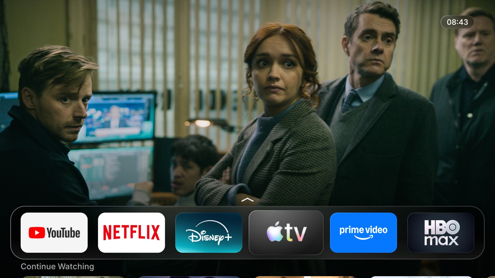
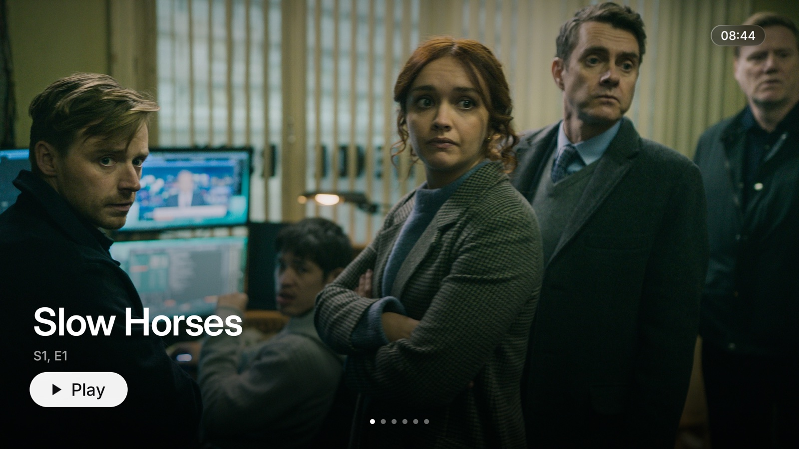
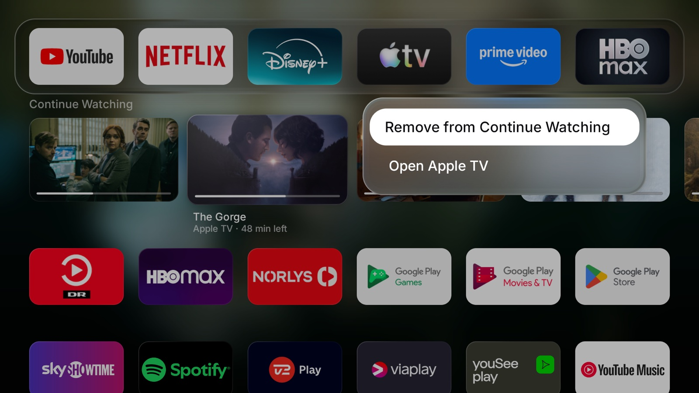
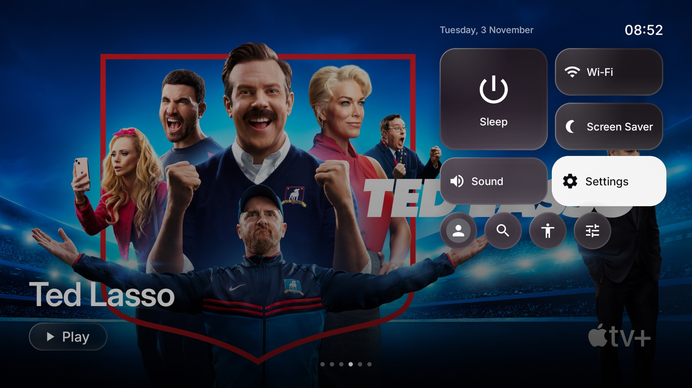

# Atrium

**An Apple TV style home screen for Chromecast with Google TV.**

Atrium replaces the Google TV home screen with one modelled on Apple TV's, including its Liquid Glass look. You get full-screen artwork, a top row of your six favorite apps, and Continue Watching across your apps, without Google TV's ads and suggested rows. Your apps stay exactly as they are.

## The home screen

Move along the top row and the screen fills with artwork from that app. A small arrow shows there's more above.

Press **Up** and the picture opens to full screen, with **Play** and page dots. **Left** and **Right** change program, and it moves on by itself after a while.

| At rest | Press Up |
|---|---|
|  |  |

Apps with no artwork light the screen in their own color instead. Apps that only share small thumbnails, like YouTube, show a row of them above the top row, so nothing gets stretched and blurry.

## Continue Watching

One row with what you're in the middle of across your apps, most recent first, with a progress bar on each tile. Select a tile to pick up where you left off. The row updates when you come back from an app.

Don't want something there? Hold **Select** on it to remove it. It comes back once you watch more of it, and the app's own list isn't changed.

## All your apps

Everything else sits in a grid below, using Apple's six-column layout, over a frosted copy of the artwork. Hold **Select** on an app to rearrange it, move it to the top row, put it in a folder, hide it or delete it.

## Control Center

Press **Up** to reach the clock and then **Select**, or just hold **Home**. Glass tiles float over whatever's on screen, with Sleep, Wi-Fi, Screen Saver, Sound, Settings, Search and more.

## Screen saver

After a few idle minutes, or when you press **Back** on the first app in the top row, Atrium plays looping nature scenes or your own photos. The scenes are original, generated by a script in this project.

**Up** picks a category, **Left** and **Right** change scene, and **Down** names it. Anything else stops it.

## Settings

A plain list like Apple TV's, explaining each row as you reach it. Choose a wallpaper from seven gradients or your own photos, and control the clock, screen saver, click sounds and hidden apps.

## Using the remote

| Button | What it does |
|---|---|
| **Select** | Open what's selected |
| **Hold Select** | Show options for that app or program |
| **Up** on the top row | Open the artwork to full screen |
| **Down** from the top row | Go to Continue Watching and your apps |
| **Back** | Return to the top row, then start the screen saver from the first app |
| **Home** | Go to Atrium, or back to the first app if you're already there |
| **Hold Home** | Open Control Center |

The two **Home** actions need the optional Home Button service. Without it, Home goes to Google TV, and you open Atrium from your apps list.

## Good to know

- **Devices:** it's been tested on a Chromecast with Google TV (2020) running Android 14. It only runs on Android TV and Google TV devices, and other models are untested.
- **Artwork:** pictures and programs come from what each app shares, so quality varies from app to app.
- **Home button:** Google TV can't change its default home screen, so Atrium brings itself to the front instead. You may see a brief flash of Google TV, especially when the TV wakes up.
- **Glass:** it's a lookalike built for the Chromecast's modest graphics chip, not Apple's real-time Liquid Glass.
- **Sleep:** the Sleep button needs the Home Button service and hasn't been fully tested yet.

## Get started

Installing takes a computer on the same Wi-Fi as your TV, and nothing about Google TV is removed, so you can go back at any time. See [install and development](docs/INSTALL.md).

---

Atrium is an independent project, not made by or affiliated with Apple or Google. Screenshots are from a real Chromecast. Artwork comes from the Apple TV app and belongs to its owners, and app logos belong to their companies.
