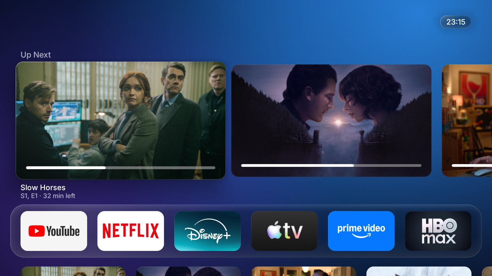
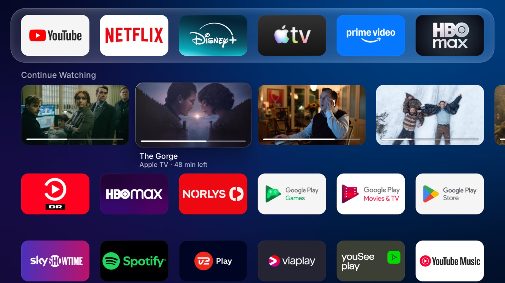
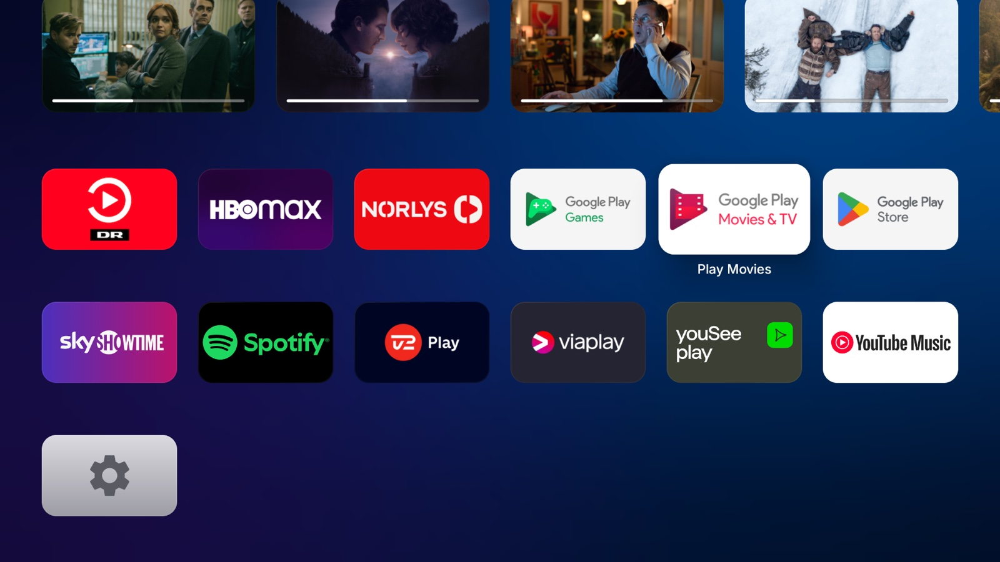
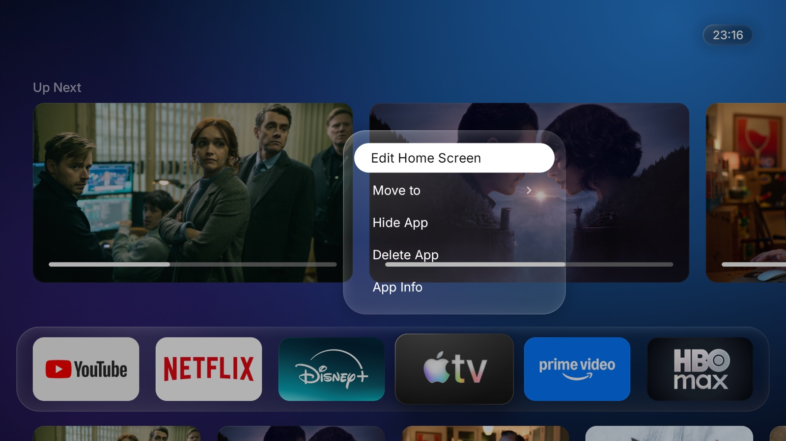
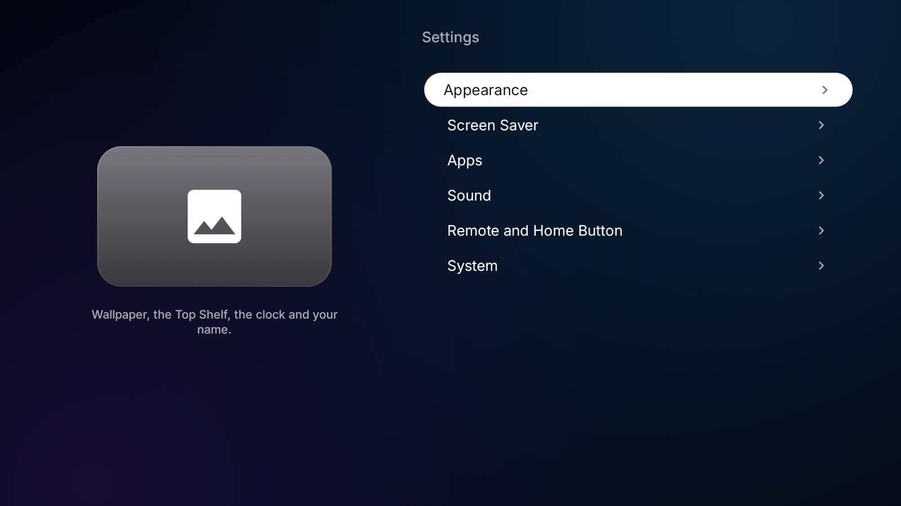

# Atrium

**An Apple TV style home screen for Chromecast with Google TV.**

Atrium replaces the Google TV home screen with one modelled on Apple TV's, including its Liquid Glass look. You get a top row of your six favorite apps, each showing what's next in it, and Continue Watching across your apps, without Google TV's ads and suggested rows. Your apps stay exactly as they are.

## The home screen

Move along the top row and each app shows its own row above it, as Apple TV's Top Shelf does: what you're in the middle of in that app, labelled **Up Next**, then what it recommends. The screen takes on the color of the program in focus, and the tops of the row below peek in at the bottom edge.

Press **Up** to move into the row. The program in focus shows its title and where you are, or how long it is, and **Select** plays it.

| The top row | In an app's row |
|---|---|
|  |  |

## Continue Watching

Press **Down** from the top row for one row with what you're in the middle of across your apps, most recent first, with a progress bar on each tile. Select a tile to pick up where you left off. The row updates when you come back from an app.

Don't want something there? Hold **Select** on it to remove it. It comes back once you watch more of it, and the app's own list isn't changed.

## All your apps

Everything else sits in a grid below, using Apple's six-column layout, over a soft, dark wash of the stage's colors. Hold **Select** on an app to rearrange it, move it to the top row, put it in a folder, hide it or delete it.

Held on a tile in the top row, the menu opens just above it, so the row stays in view.

## Control Center

Hold **Home**, or press **Up** to reach the clock and then **Select**. Glass tiles float over whatever's on screen, with Sleep, Wi-Fi, Screen Saver, Sound, a Sleep Timer, Search and Accessibility. Sound, Wi-Fi and the Sleep Timer open their own glass panels. Tabs along the top work as on Apple TV: **Left** and **Right** move between them, and when music or a podcast is playing or paused in any app that shares it, like Spotify, a Now Playing tab appears with its timeline and controls, and selecting the song opens that app. Small icons by the clock show when there's no internet, a Sleep Timer is running, something is playing, or headphones are connected.

## Screen saver

After a few idle minutes, or when you press **Back** on the first app in the top row, Atrium plays looping nature scenes or your own photos. The scenes are original, generated by a script in this project.

**Up** picks a category, **Left** and **Right** change scene, and **Down** names it. Anything else stops it. Like Apple TV, it has a **Show During Music and Podcasts** setting: turn it off and the screen saver won't start by itself while something is playing. While music plays, a small glass card with moving audio bars names the song over the moving scenery. Click to fill the screen with its cover, the song and a timeline, and click or press **Back** to return to the scenery. The cover also leaves by itself after a minute, so nothing large stays put on the screen.

## Settings

Organized like Apple TV's: a short list of topics, each opening its own page, with a large picture and an explanation beside the row you're on. Choose a wallpaper from seven gradients or your own photos, and control the clock, screen saver, click sounds and hidden apps.

## Using the remote

| Button | What it does |
|---|---|
| **Select** | Open what's selected |
| **Hold Select** | Show options for that app or program |
| **Up** on the top row | Move into that app's row of programs |
| **Down** from the top row | Go to Continue Watching and your apps |
| **Back** | Return to the top row, then start the screen saver from the first app |
| **Home** | Go to Atrium, or back to the first app if you're already there |
| **Hold Home** | Open Control Center |

The two **Home** actions need the optional Home Button service. Without it, Home goes to Google TV, and you open Atrium from your apps list.

## Good to know

- **Devices:** it's been tested on a Chromecast with Google TV (2020) running Android 14. It only runs on Android TV and Google TV devices, and other models are untested.
- **Apps' rows:** the programs come from what each app shares with Google TV, so some show more than others. Netflix, for example, shares only what you're watching.
- **Home button:** Google TV can't change its default home screen, so Atrium brings itself to the front instead. You may see a brief flash of Google TV, especially when the TV wakes up.
- **Glass:** it's a lookalike built for the Chromecast's modest graphics chip, not Apple's real-time Liquid Glass.
- **Sleep:** Sleep and the Sleep Timer need the Home Button service.
- **Volume:** the remote sets the TV's volume directly, and an app can't reach it over HDMI, so the Sound panel only has volume buttons for headphones.
- **Wi-Fi:** the panel shows the connection's status, signal and IP address. Showing the network's name would need the location permission, and changing networks opens Android's settings.
- **Now Playing:** this is off until you turn on "Atrium Now Playing" under Notification Access, which Atrium's Settings links to. Android asks for that access to share what's playing, and Atrium doesn't read your notifications.

## Get started

Installing takes a computer on the same Wi-Fi as your TV, and nothing about Google TV is removed, so you can go back at any time. See [install and development](docs/INSTALL.md).

---

Atrium is an independent project, not made by or affiliated with Apple or Google. Screenshots are from a real Chromecast. Artwork comes from the Apple TV app and belongs to its owners, and app logos belong to their companies.
